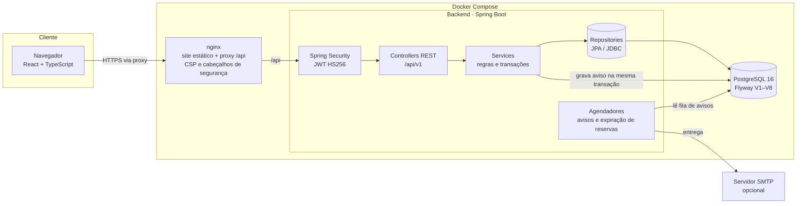
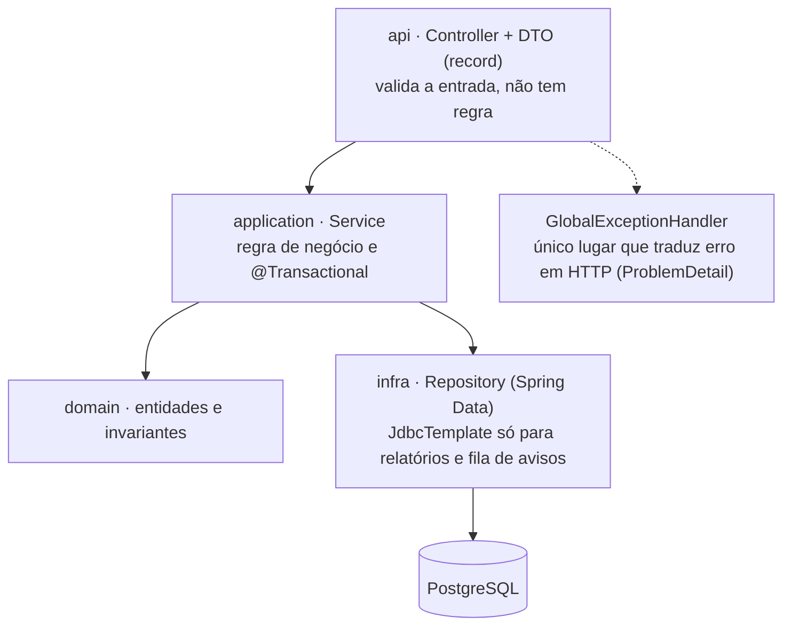
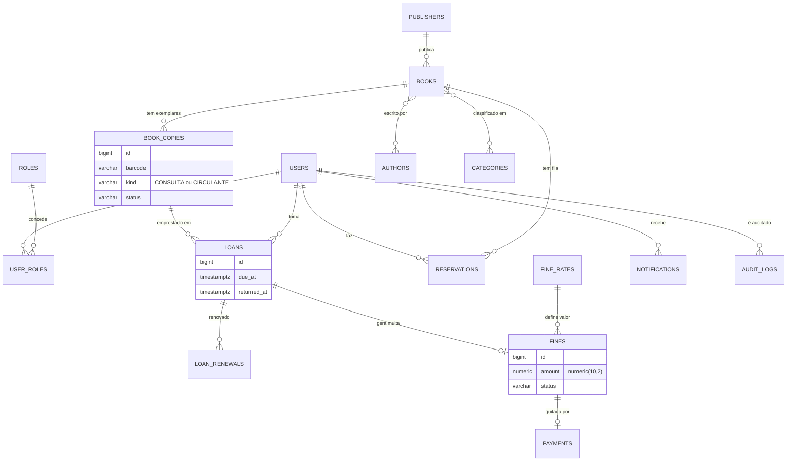
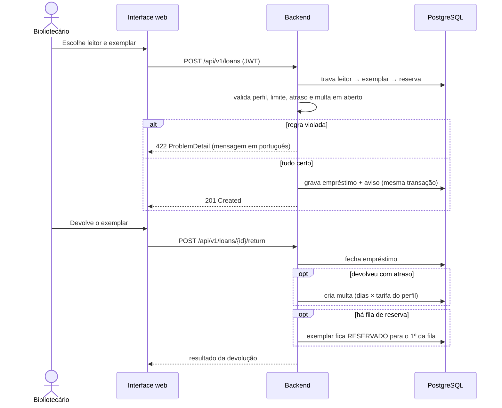

<div align="center">

# Biblioteca Digital 360

**Sistema Integrado de Gestão Bibliotecária (SIGB) para instituições de ensino**

Acervo · Usuários · Empréstimos · Reservas · Renovações · Multas · Pagamentos · Relatórios

[](https://github.com/josewilson/Biblioteca-Digital-360/actions/workflows/ci.yml)


</div>

---

## Sumário
- [Visão geral](#visão-geral)
- [Funcionalidades](#funcionalidades)
- [Arquitetura](#arquitetura)
- [Modelo de dados](#modelo-de-dados)
- [Fluxo de empréstimo e devolução](#fluxo-de-empréstimo-e-devolução)
- [Regras de negócio](#regras-de-negócio)
- [Estrutura do projeto](#estrutura-do-projeto)
- [Tecnologias](#tecnologias)
- [Como executar](#como-executar)
- [Testes e qualidade](#testes-e-qualidade)
- [Segurança](#segurança)
- [Documentação](#documentação)
- [Limitações conhecidas](#limitações-conhecidas)

## Visão geral
O projeto nasceu como um exercício de aula ("Biblioteca do Bairro", SOLID, código já removido) e foi reconstruído como um sistema de
biblioteca completo: API REST em Spring Boot sobre PostgreSQL e uma interface web em React, entregues em containers e
verificadas por um pipeline de CI com testes de unidade, de integração com banco real e de ponta a ponta com
auditoria de acessibilidade.

O ponto central do domínio: **obra** e **exemplar** são coisas diferentes. Toda obra tem pelo menos um exemplar de
**consulta** (nunca sai da biblioteca) e pelo menos um **circulante** (pode ser emprestado). Essa regra é garantida
pelo próprio banco, não só pelo código.

## Funcionalidades
| Área | O que faz |
|---|---|
| **Acervo** | Obras com autores, editoras, categorias e exemplares; regra consulta + circulante imposta no cadastro e na baixa |
| **Balcão** | Empréstimo, devolução e renovação, com limite por leitor (padrão 3), bloqueio por atraso ou multa em aberto |
| **Reservas** | Fila por obra; o exemplar devolvido fica guardado para o 1º da fila, com prazo de retirada e expiração |
| **Multas** | Por dia de atraso, valor configurável por perfil, em `BigDecimal`; pagamento com comprovante; isenção autorizada com justificativa |
| **Relatórios** | Painel gerencial com gráficos e 8 relatórios em JSON ou CSV (com proteção contra injeção de fórmula) |
| **Avisos** | Empréstimo, vencimento, atraso, reserva, multa e pagamento, por e-mail (canal `log` ou `smtp`), com tentativas limitadas |
| **Usuários** | 8 perfis (de super administrador a visitante), cadastro, desativação, auditoria de login e bloqueio por tentativas |
| **Área do leitor** | Cada leitor vê só os próprios empréstimos, reservas e multas |

## Arquitetura
Monólito modular: um backend e uma SPA que só conversa com a API REST. Em produção, o nginx serve o site e repassa
`/api` ao backend; **só o nginx fica exposto**.



### Camadas do backend


### Decisões que merecem destaque
- **O banco garante as regras críticas:** chave estrangeira composta impede empréstimo de exemplar de consulta; índices únicos parciais impedem dois empréstimos ativos do mesmo exemplar, duas multas por empréstimo e dois pagamentos por multa.
- **Concorrência:** travas de linha (`PESSIMISTIC_WRITE`) sempre na mesma ordem (leitor → exemplar → reserva), sem deadlock; testado com requisições simultâneas.
- **Avisos fora da transação:** a operação grava o aviso junto; um agendador entrega depois. Falha de e-mail nunca desfaz um empréstimo.
- **Relógio injetado (`Clock`):** "dia de atraso" segue `America/Sao_Paulo`, e os testes andam no tempo sem esperar.
- **Autorização no servidor:** a interface esconde botões por perfil só por conveniência.
- **Sem segredo no código:** `DB_PASSWORD` e `JWT_SECRET` não têm valor padrão; a aplicação recusa iniciar sem eles.

## Modelo de dados

Detalhes e índices em [docs/DATABASE.md](docs/DATABASE.md).

## Fluxo de empréstimo e devolução


## Regras de negócio
- Toda obra tem **no mínimo 2 exemplares**, sendo **pelo menos 1 de consulta**, que nunca é emprestado.
- Todos os leitores, inclusive visitante, usam o exemplar de consulta no local. **Visitante não empresta.**
- Aluno, professor e funcionário: até **3 empréstimos** simultâneos (configurável).
- Multa = dias corridos de atraso × tarifa diária do perfil (editável em `fine_rates`). Valores em reais com 2 casas.
- Quem tem atraso ou multa em aberto não empresta. Funcionários também pagam multa.
- Resumo completo em [docs/BUSINESS_RULES.md](docs/BUSINESS_RULES.md).

## Estrutura do projeto
```text
Biblioteca-Digital-360/
├── backend/                         API Spring Boot (Maven)
│   ├── src/main/java/br/com/biblioteca/
│   │   ├── acervo/                  obras, exemplares, autores, editoras, categorias
│   │   ├── loan/                    empréstimo, devolução, renovação, reserva, multa, pagamento
│   │   ├── user/ security/          usuários, perfis, login JWT, bloqueio por tentativas
│   │   ├── notification/            fila de avisos, canais log/smtp, vencimento e atraso
│   │   ├── report/                  painel e relatórios (SQL de leitura, CSV)
│   │   └── audit/ shared/           auditoria, erros (ProblemDetail), relógio, validações
│   ├── src/main/resources/
│   │   ├── application.yml          configuração por variáveis de ambiente
│   │   └── db/migration/            Flyway V1–V8
│   ├── src/test/                    unitários, integração e Testcontainers
│   ├── Dockerfile                   imagem do backend (multi-stage, usuário não root)
│   └── pom.xml · mvnw · mvnw.cmd    build Maven (wrapper incluso)
├── frontend/                        SPA React + TypeScript (Vite)
│   ├── src/lib/                     cliente HTTP, autenticação, formatação, tipos
│   ├── src/components/              UI própria (Tailwind), layout, seletores
│   ├── src/pages/                   uma página por tela
│   ├── e2e/                         Playwright + axe (acessibilidade)
│   ├── nginx/                       servidor web e cabeçalhos de segurança
│   └── Dockerfile                   imagem do site (node → nginx)
├── docs/                            API, arquitetura, banco, segurança, testes, design...
├── .github/                         workflow de CI e Dependabot
├── docker-compose.yml               banco (sempre) + backend e site (perfil `full`)
├── AGENTS.md                        regras para pessoas e agentes de IA
├── LEIA-ME.md                       guia de configuração e execução em detalhe
└── README.md                        esta página
```

## Tecnologias
| Camada | Stack |
|---|---|
| Backend | Java 21 · Spring Boot 4.1 (Web MVC, Validation, Data JPA, Security + OAuth2 Resource Server, Actuator, Mail) · Flyway · Maven |
| Banco | PostgreSQL 16 |
| Frontend | React 19 · TypeScript 7 (strict) · Vite 8 · React Router 8 · TanStack Query 5 · React Hook Form + Zod 4 · Tailwind CSS 4 · Recharts 3 · Lucide |
| Testes | JUnit 5 · Mockito · Testcontainers · Vitest + Testing Library · Playwright + axe-core |
| Entrega | Docker · Docker Compose · nginx · GitHub Actions · Dependabot |

## Como executar
### Tudo em Docker (mais rápido)
Crie um `.env` na raiz (o Git o ignora) com valores seus:
```bash
DB_PASSWORD=<senha forte do banco>
JWT_SECRET=<texto aleatório com 32+ caracteres>   # ex.: openssl rand -base64 48
ADMIN_EMAIL=<e-mail do primeiro administrador>
ADMIN_PASSWORD=<senha do administrador, mínimo 8 caracteres>
```
```bash
docker compose --profile full up -d --build
```
Abra `http://localhost:3000` e entre com o administrador. Depois do primeiro acesso, remova `ADMIN_*` do `.env`.

### Desenvolvimento
```bash
docker compose up -d                  # só o PostgreSQL (porta 5433 por padrão; mude com DB_PORT)
export DB_PASSWORD=... JWT_SECRET=... # a aplicação não lê o .env sozinha
cd backend && ./mvnw spring-boot:run              # API em http://localhost:8080
cd frontend && npm install && npm run dev   # site em http://localhost:5173 (proxy /api)
```
No PowerShell: `$env:DB_PASSWORD="..."; $env:JWT_SECRET="..."; cd backend; .\mvnw.cmd spring-boot:run`.
Pré-requisitos: JDK 21, Docker e Node 20.19+ (testado com 24). Variáveis, e-mail SMTP e demais detalhes no [LEIA-ME.md](LEIA-ME.md) e em [docs/DEPLOYMENT.md](docs/DEPLOYMENT.md).

## Testes e qualidade
```bash
cd backend && ./mvnw verify                                 # backend: 155 testes (com PostgreSQL real via Testcontainers)
cd frontend && npm test                         # frontend: 76 testes
cd frontend && npm run e2e:up && npm run e2e && npm run e2e:down   # 33 testes de ponta a ponta + axe
```
O CI roda três jobs: **backend**, **frontend** (tipos, testes, build e `npm audit`) e **ponta a ponta** (pilha completa em
Docker, navegador real e auditoria de acessibilidade em desktop e celular). Há regressão automática contra consultas N+1.
Detalhes em [docs/TESTING.md](docs/TESTING.md) e [docs/PERFORMANCE.md](docs/PERFORMANCE.md).

## Segurança
JWT com expiração · bloqueio de login após 5 falhas em 15 min (HTTP 429) · comparação de senha em tempo constante ·
autorização por URL antes da validação do corpo · CSP restritiva na API e no nginx · proteção contra XSS (sem
`dangerouslySetInnerHTML`) · proteção contra injeção de fórmula em CSV · SQL sempre parametrizado · segredos só por
ambiente · containers sem root · banco publicado apenas em `127.0.0.1`. Revisão completa em
[docs/SECURITY.md](docs/SECURITY.md).

## Documentação
| Documento | Conteúdo |
|---|---|
| [LEIA-ME.md](LEIA-ME.md) | Configuração e execução em detalhe |
| [docs/ARCHITECTURE.md](docs/ARCHITECTURE.md) | Visão técnica e decisões |
| [docs/API.md](docs/API.md) | Endpoints e DTOs |
| [docs/DATABASE.md](docs/DATABASE.md) | Esquema, constraints e índices |
| [docs/BUSINESS_RULES.md](docs/BUSINESS_RULES.md) | Regras de negócio |
| [docs/SECURITY.md](docs/SECURITY.md) | Modelo de ameaças e revisão |
| [docs/TESTING.md](docs/TESTING.md) | Estratégia e como rodar os testes |
| [docs/DEPLOYMENT.md](docs/DEPLOYMENT.md) | Implantação, HTTPS, backup |
| [docs/DESIGN.md](docs/DESIGN.md) | Direção visual "ficha de empréstimo" |
| [docs/PERFORMANCE.md](docs/PERFORMANCE.md) | Medições e otimizações |
| [docs/ROADMAP.md](docs/ROADMAP.md) | Fases e próximos passos |
| [AGENTS.md](AGENTS.md) | Convenções para contribuir (pessoas e IA) |

## Limitações conhecidas
Não existem ainda: OpenAPI/Swagger, HTTPS embutido (use um proxy com certificado),
exclusão de obra e busca automática de capa pelo ISBN. O teste de carga (`loadtest/`) cobre só leituras. Entrega de avisos pressupõe **uma única
instância** do backend. O envio por SMTP é testado contra um servidor local (Mailpit), não contra o seu provedor. Lista completa no [roadmap](docs/ROADMAP.md).
